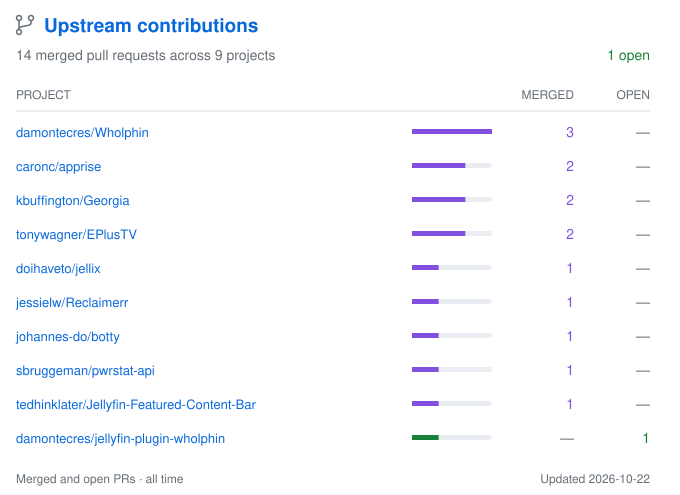

# 👋 Hi, I'm voc0der
🕓 ***Joined Github 10 years ago***

Full stack developer. I build tools for self-hosting, media libraries, and gaming.

Some of the projects I work on:

| Project | What it does |
| --- | --- |
| [Coldarr](https://github.com/voc0der/Coldarr) | Moves older movies and shows to overflow storage through Radarr and Sonarr. |
| [ytdl-material](https://github.com/voc0der/ytdl-material) | A self-hosted app for downloading, organizing, and watching video and audio. |
| [reddont](https://github.com/voc0der/reddont) | A self-hosted, read-only Reddit client with custom themes, feeds, and subscriptions. |
| [Jellyfin plugins](https://github.com/voc0der/jellyfin-plugins) | Plugins for IMDb ratings, transcoding controls, watch-history recovery, and Seerr integration. |
| [NWNLogRotator](https://github.com/voc0der/NWNLogRotator) | Saves, cleans, and colorizes Neverwinter Nights chat logs as HTML. |

I also work on World of Warcraft addons, including [OneButtonMount](https://github.com/voc0der/OneButtonMount), [Deathlapse](https://github.com/voc0der/Deathlapse), and [Grouper](https://github.com/voc0der/Grouper).

[More projects →](https://github.com/voc0der?tab=repositories)

<a href="https://github.com/search?q=is%3Apr+author%3Avoc0der+-user%3Avoc0der+is%3Apublic&amp;type=pullrequests">
  <picture>
    <source media="(prefers-color-scheme: dark)" srcset="assets/contributions-dark.svg">
    
  </picture>
</a>

Public pull requests to other projects. Updated daily. Click the panel to browse the contributions.
